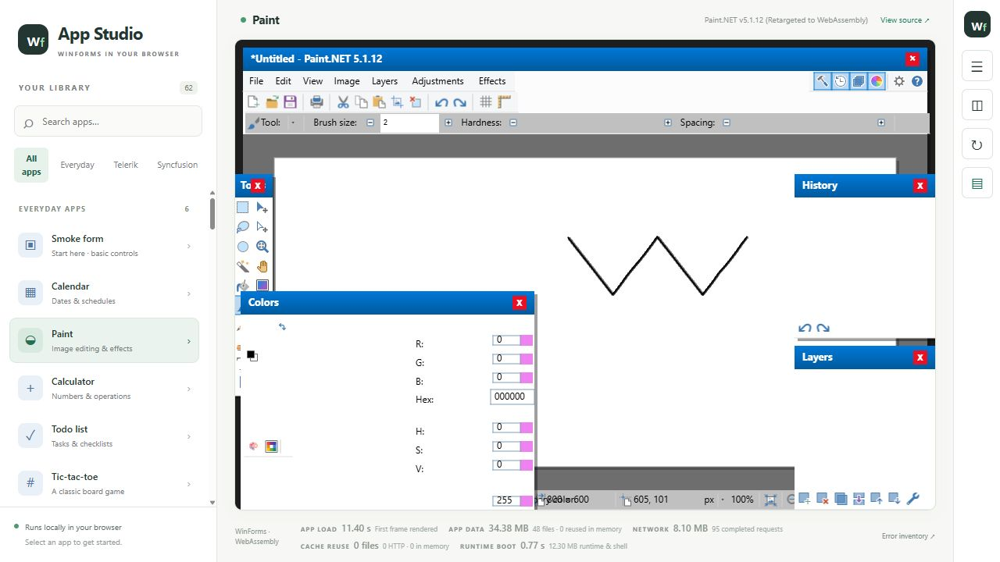
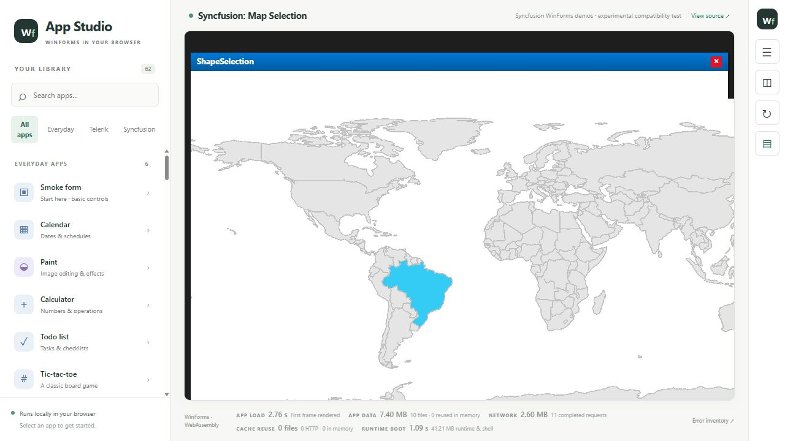
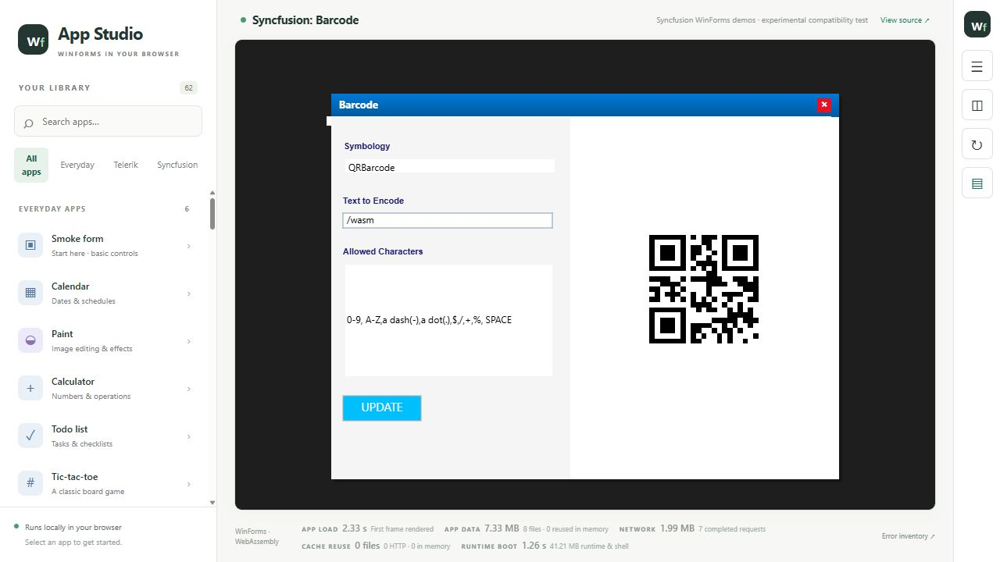
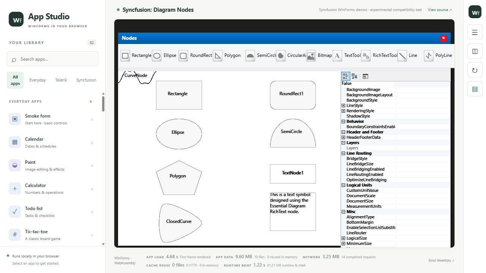
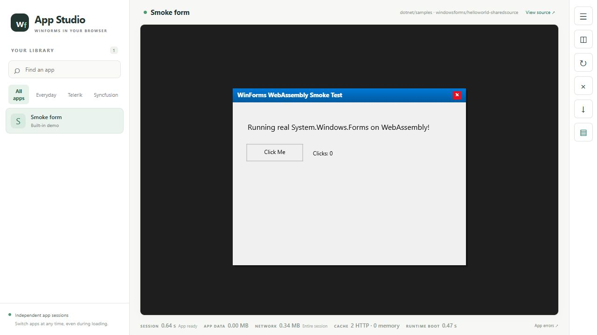

# winforms-wasm

**Old software still has work to do.**

An experiment in bringing existing Windows Forms applications to the browser with .NET and WebAssembly.

**Work in progress:** selected applications run today; compatibility and behavior are still being developed and tested.

## Why this exists

An old application can hold years of business knowledge: a pricing rule nobody remembers writing, an exception discovered the hard way, a workflow refined by the people who use it every day. Its interface may look dated, but the knowledge inside it can still be valuable.

AI is making repetitive development work dramatically easier, and I want to use it. This project is not an argument against AI. It starts from a practical concern: migrating an established application can introduce regressions in business rules that are difficult to discover and expensive to relearn. Translating the code is only part of the job; preserving its decisions, edge cases, and familiar behaviors is much harder.

So I wanted to try another route: **what if we could give these programs another place to live?**

The idea is to **use AI to convert the “SAFE” part**: the runtime, drawing layer, and platform integration around the application, while keeping its established business logic in place. Those boundaries give us a smaller scope to inspect, test, and improve. “SAFE” means a more controlled place to make changes, not a promise that compatibility work cannot introduce regressions.

`winforms-wasm` explores that approach by running existing managed code in a browser and adapting Windows Forms around it. The original application files stay untouched; the compatibility layer works with rewritten copies. The hope is to preserve more of what already works, extend the useful life of existing software, and give people more room to modernize at their own pace.

This is an early experiment. Selected applications render and respond to input today. Compatibility is incomplete, and preserving behavior still requires testing each application's real workflows.

## Recent progress — October 2026

The experiment now covers more of the platform around a real desktop application:

- **An independent app library and runtime sessions.** Search/filter the library, switch apps during startup, stop/restart a session, and inspect errors attributed to the app and session that produced them. Load time, app payload, network transfer and cache reuse are reported separately.
- **A wider compatibility corpus.** The local catalog has 62 entries, including 42 selected Syncfusion samples spanning editors, grids, diagrams, maps, charts, navigation and documents. The catalog is a way to expose missing behavior; it is not a claim that all these applications work. A source-only checkout shows only apps whose inputs are actually present.
- **More runtime and drawing compatibility.** New work covers image lists/resources, rich-text streaming and drawing, cursors/dialog hooks, layout/input plumbing, and additional Windows API boundaries. The Syncfusion diagram node gallery now reaches its real form and rich-text nodes in the captured development build.
- **A retained-rendering foundation and WebGL2 experiments.** Rendering commands, surface/resource lifetimes, composition and a GLES/WebGL binding now have dedicated tests and a browser probe. Normal application painting still uses the CPU path; broad GPU acceleration and its performance acceptance remain work in progress.
- **Platform-service foundations.** A separate demo and server/browser modules explore declared file mounts, browser file selection, scoped virtual registry storage and browser printing. Wiring these services consistently into existing applications is still incomplete; the presence of the demo is not full WinForms API parity.
- **Tests that distinguish launch from behavior.** New shell-isolation, pixel, platform, rewrite and browser-gallery checks exercise real failure paths and selected workflows. The gallery runner is an early implementation with explicitly blocked/untested dimensions, not a certification engine. Missing hardware evidence cannot pass the GPU acceptance gate.

See the [progress and validation notes](docs/progress-2026-10.md) for what was checked in this source update and what remains open.

## See it running

The following are **unaltered captures from the live local browser on 21 October 2026**, at its normal viewport. They show existing application code and its supported behavior, including visible limitations. They are not desktop reference images or full compatibility claims.



**Paint.NET 5.1.12 remains the most ambitious showcase.** The editor loads and real brush input changes the document and its modified state. It is still partially working: panels, rendering, editing commands, effects and file workflows need further compatibility work. This capture establishes basic drawing, not a complete image editor.



*Map Selection: clicking Brazil highlights its actual polygon. This exercises shape rendering and hit testing; map zoom/pan and full data workflows were not certified.*



*Barcode: real keyboard input and UPDATE regenerate the QR code. An independent image decoder reads the exact value `/wasm` from this capture.*



*Diagram Nodes: the sample reaches its actual gallery, including geometric and rich-text nodes and a property grid. This image documents startup/rendering progress; drag/edit/serialization parity is not established by this capture.*

[Capture details and earlier Calculator/Photo Album interactions](docs/screenshots/README.md) describe the exact actions and limits. The separately obtained application binaries, commercial libraries, loose assets and converted assemblies are **not included**. Names and artwork belong to their respective owners. The larger local library shown in these captures is not the content of a fresh checkout.

## How it works

1. **Adapt the runtime.** A fork of the .NET Windows Forms sources uses a managed browser backend. A replacement drawing layer renders the supported drawing operations.
2. **Adapt copies of the assemblies.** An IL rewriter redirects framework references and applies compatibility transformations. The source application remains unchanged on disk.
3. **Run in WebAssembly.** The .NET browser runtime executes the managed code. A canvas bridge presents the rendered output and routes mouse and keyboard input back to the application.
4. **Request dependencies as they are needed.** App startup requests its entry assembly. When the runtime asks for another assembly, the server looks it up by name in configured folders, transforms it, and returns it. It does not send every DLL in the folder or require rebuilding the browser host for each app.

The library shell hosts each app in a separate runtime frame with its own session identity. The local server serves the browser host and prepares assemblies. The application executes in the browser. The host reports time to the first canvas frame, application payload size, measured network transfer, and cache reuse separately.

The shared compatibility runtime is built with the host. Application DLLs remain separate and are requested dynamically. Loose content such as images and XML currently loads during app startup. Limited manifest-declared dependency warm-up is separate from the fallback resolver; it does not turn every lookup folder into a download bundle. The assembly resolution bridge currently uses synchronous requests, which can pause the UI while a new dependency arrives.

## Build and run the base project

The current build workflow uses **Windows, PowerShell, and the .NET 9 SDK**. From the repository directory:

```powershell
dotnet workload restore src/WfWasm.CanvasHost/WfWasm.CanvasHost.csproj
./scripts/build.ps1 -Run
```

Open [http://127.0.0.1:5210](http://127.0.0.1:5210). The checkout starts with the built-in smoke form; external applications appear only when their files are available locally. No third-party application is required to build or open the base project.



*What a source-only build includes: the base runtime and its built-in form. External app inputs are optional and remain local.*

The script builds the fork and rewriter, generates the browser-compatible runtime under the ignored `.artifacts/` directory, and builds the host. See [build instructions](docs/building.md) for individual steps, tests, and locally supplied applications.

## Current scope

The project exercises form layout, controls, managed drawing, input routing, resources, and dynamic assembly delivery. Calculator input and Photo Album dragging are examples of working interactions, not certifications of complete application compatibility.

Native Win32 calls, COM, shell integration, printing, operating system services, modal behavior, and graphics APIs need compatibility work. Some paths are partial implementations or stubs. Canvas rendering also needs more work on accessibility, text, layout fidelity, and performance. Existing application behavior can still regress across these boundaries.

This is a local development host. Use trusted application binaries and keep the host bound to loopback; it has no production authentication or multi-user isolation. Browser execution does not make the server-side assembly processing safe for arbitrary uploads.

## Help useful software live longer

Good contributions start with a small, reproducible behavior: a control that paints incorrectly, a workflow that stops, an assembly that resolves differently, or a slow interaction. A generic compatibility fix with a focused regression test helps many applications at once.

See [architecture](docs/architecture.md), [testing](docs/testing.md), [contributing](CONTRIBUTING.md), and the [roadmap](docs/roadmap.md).

## Licenses and acknowledgments

Original project code is provided under the [MIT license](LICENSE). The adapted Windows Forms code retains the [.NET Foundation license](runtimes/winforms/LICENSE.TXT) and [third-party notices](runtimes/winforms/THIRD-PARTY-NOTICES.TXT). Vendored browser libraries have their own preserved licenses; see [third-party notices](THIRD-PARTY-NOTICES.md).

This project builds on [dotnet/winforms](https://github.com/dotnet/winforms), the .NET WebAssembly runtime, and [Mono.Cecil](https://github.com/jbevain/cecil). It is an independent experiment, with no affiliation or endorsement implied by the applications shown.
