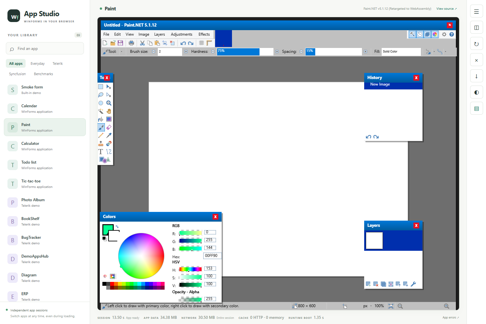
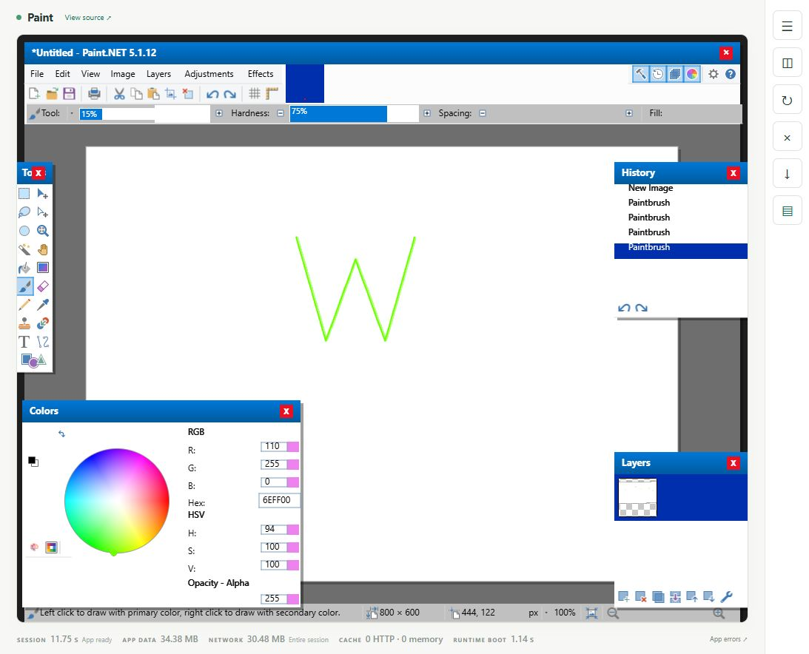
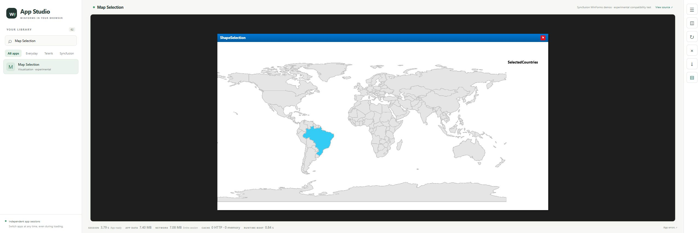
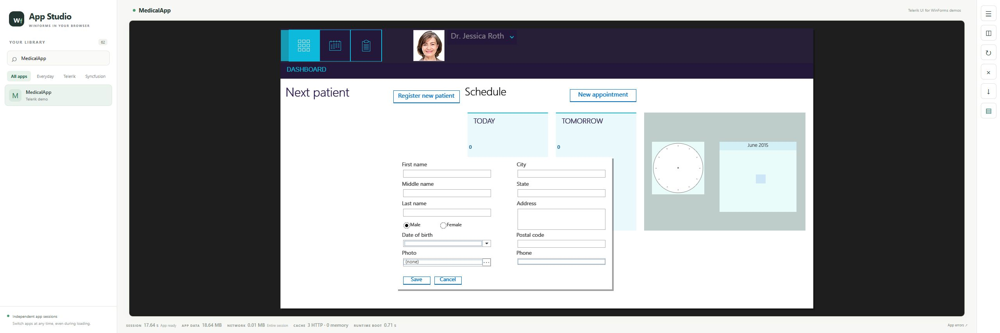
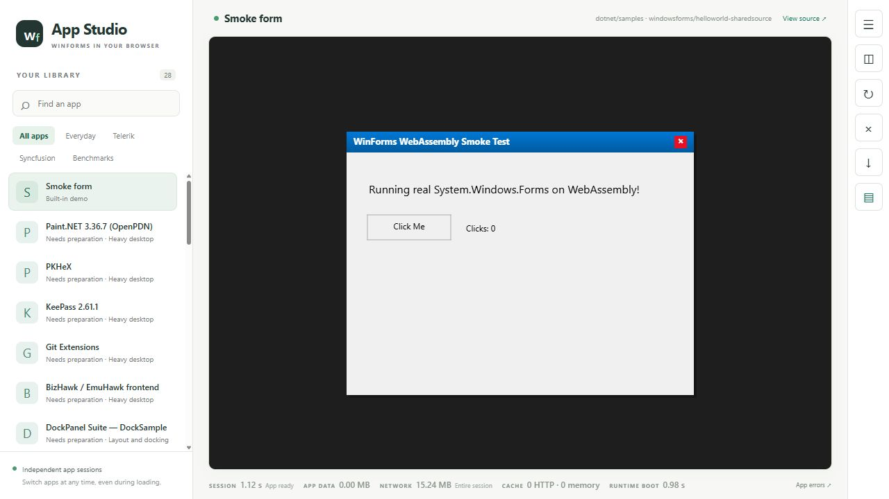
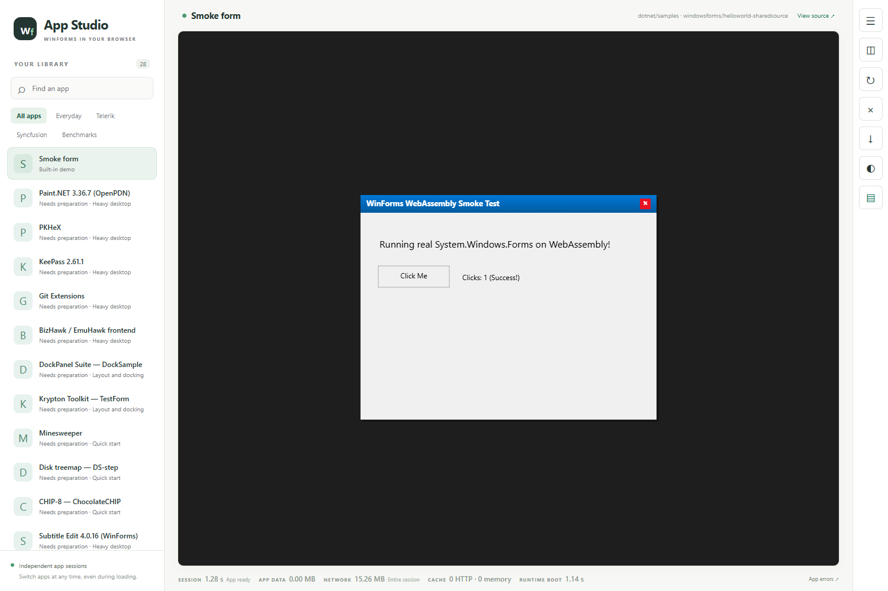

# winforms-wasm

**Old software still has work to do.**

An experiment in bringing existing Windows Forms applications to the browser with .NET and WebAssembly.

**Work in progress:** selected applications run today; compatibility and behavior are still being developed and tested.

## Why this exists

An old application can hold years of business knowledge: a pricing rule nobody remembers writing, an exception discovered the hard way, a workflow refined by the people who use it every day. Its interface may look dated, but the knowledge inside it can still be valuable.

AI is making repetitive development work dramatically easier, and I want to use it. This project is not an argument against AI. It starts from a practical concern: migrating an established application can introduce regressions in business rules that are difficult to discover and expensive to relearn. Translating the code is only part of the job; preserving its decisions, edge cases, and familiar behaviors is much harder.

So I wanted to try another route: **what if we could give these programs another place to live?**

The idea is to **use AI to convert the “SAFE” part**: the runtime, drawing layer, and platform integration around the application, while keeping its established business logic in place. Those boundaries give us a smaller scope to inspect, test, and improve. “SAFE” means a more controlled place to make changes, not a promise that compatibility work cannot introduce regressions.

`winforms-wasm` explores that approach by running existing managed code in a browser and adapting Windows Forms around it. The original application files stay untouched; the compatibility layer works with rewritten copies. The hope is to preserve more of what already works, extend the useful life of existing software, and give people more room to modernize at their own pace.

This is an early experiment. Selected applications render and respond to input today. Compatibility is incomplete, and preserving behavior still requires testing each application's real workflows.

## Latest update — 24 October 2026

Paint.NET's Colors panel now displays the palette strip, color wheel and RGB/HSV/opacity controls together. In a fresh browser check, selecting a palette cell changed the primary swatch, wheel marker and displayed color to **RGB 0, 255, 144 / #00FF90**. The Layers tool window and its thumbnail are visible, but full independent-layer behavior remains unverified.



This source update also includes rectangular clipping/fill corrections, retained scroll-shift groundwork, explicit opt-in diagnostics, native/resource compatibility fixes and stronger browser-test acceptance checks. Normal application painting still uses CPU bitmaps; these changes are not a broad GPU-acceleration or performance acceptance claim.

**Still experimental:** the longer Paint.NET brush/layer check exposed a runtime-ending command-list cleanup failure. The source build and focused base gate pass; the broader unfiltered native run has **1,906 passes and 25 failures**, including missing integration inputs and unresolved defects. We are publishing the progress with those limits visible, not claiming that all editing workflows or benchmarks work.

See [the new captures, validation and remaining work](docs/update-2026-10-24-colors-and-panels.md), the [previous panel/thumbnail update](docs/update-2026-10-22-panels.md), and [integration architecture](docs/integration-bridges.md). Application files and converted assemblies remain excluded.

## Recent progress — October 2026

The experiment now covers more of the platform around a real desktop application:

- **Expanded desktop benchmarks.** Historical OpenPDN, PKHeX, KeePass, Git Extensions, BizHawk, DockPanel Suite, Krypton, Minesweeper, DS-step and ChocolateCHIP now have pinned catalog entries and a local preparation workflow. The expanded library has 27 candidates: 25 prepared inputs and two build-blocked inputs. The five vendor entries now have actual prepared inputs; see [their recipes](docs/vendor-benchmarks-preparation.md). Browser compatibility remains experimental. See [setup, current limits and acceptance tasks](docs/desktop-benchmarks.md).

- **An independent app library and runtime sessions.** Search/filter the library, switch apps during startup, stop/restart a session, and inspect errors attributed to the app and session that produced them. Load time, app payload, network transfer and cache reuse are reported separately.
- **A wider compatibility corpus.** The local catalog has 89 entries, including 42 selected Syncfusion samples spanning editors, grids, diagrams, maps, charts, navigation and documents. The catalog is a way to expose missing behavior; it is not a claim that all these applications work. A source-only checkout shows available apps plus the optional benchmark candidates, with missing inputs clearly marked.
- **More runtime and drawing compatibility.** New work covers image lists/resources, rich-text streaming and drawing, cursors/dialog hooks, layout/input plumbing, and additional Windows API boundaries. The Syncfusion diagram node gallery now reaches its real form and rich-text nodes in the captured development build.
- **A retained-rendering foundation and WebGL2 experiments.** Rendering commands, surface/resource lifetimes, composition and a GLES/WebGL binding now have dedicated tests and a browser probe. Normal application painting still uses the CPU path; broad GPU acceleration and its performance acceptance remain work in progress.
- **Platform-service foundations.** A separate demo and server/browser modules explore declared file mounts, browser file selection, scoped virtual registry storage and browser printing. Wiring these services consistently into existing applications is still incomplete; the presence of the demo is not full WinForms API parity.
- **Tests that distinguish launch from behavior.** New shell-isolation, pixel, platform, rewrite and browser-gallery checks exercise real failure paths and selected workflows. The gallery runner is an early implementation with explicitly blocked/untested dimensions, not a certification engine. Missing hardware evidence cannot pass the GPU acceptance gate.

See the [progress and validation notes](docs/progress-2026-10.md) for what was checked in this source update and what remains open.

## See it running

These are **unaltered captures from the live local browser on 22 October 2026**. They show real applications and their current limitations. External app files are supplied separately and are not distributed here.



**Paint.NET remains the most ambitious showcase.** Four real brush drags draw the W above. Four undo actions clear the document; four clicks on Paint.NET's Redo toolbar button restore it. See the fresh [undo](docs/screenshots/paint-net-panels-undo-2026-10-22.png) and [redo](docs/screenshots/paint-net-panels-redo-2026-10-22.png) captures. Independent document-region analysis finds 1,152 green pixels before undo, zero after undo, and 1,151 after redo; this supports the visible workflow, not exact pixel parity. The new panel rendering is progress, while thumbnail refresh/accuracy, remaining toolbar artifacts, effects, file operations and long-session behaviour are still incomplete. See also the earlier [partially rendered Levels dialog](docs/screenshots/paint-net-levels-2026-10-22.jpg).



*Map Selection: the real country polygon responds to a click. The selected-countries list remains empty, so this demonstrates shape rendering and hit testing while exposing a data/UI gap.*



*MedicalApp: a real button opens the registration form. Input rendering, validation and persistence are not established by this image; attempted first-name input did not produce visible text during this review. No record was saved.*

[Capture provenance and the earlier QR-code, Diagram Nodes, Calculator and Photo Album checks](docs/screenshots/README.md) describe exact actions and limits. Application names and artwork belong to their owners. The larger local library in these captures is not included in a fresh checkout.

## How it works

1. **Adapt the runtime.** A fork of the .NET Windows Forms sources uses a managed browser backend. A replacement drawing layer renders the supported drawing operations.
2. **Adapt copies of the assemblies.** An IL rewriter redirects framework references and applies compatibility transformations. The source application remains unchanged on disk.
3. **Run in WebAssembly.** The .NET browser runtime executes the managed code. A canvas bridge presents the rendered output and routes mouse and keyboard input back to the application.
4. **Request dependencies as they are needed.** App startup requests its entry assembly. When the runtime asks for another assembly, the server looks it up by name in configured folders, transforms it, and returns it. It does not send every DLL in the folder or require rebuilding the browser host for each app.

The library shell hosts each app in a separate runtime frame with its own session identity. The local server serves the browser host and prepares assemblies. The application executes in the browser. The host reports time to the first canvas frame, application payload size, measured network transfer, and cache reuse separately.

The shared compatibility runtime is built with the host. Application DLLs remain separate and are requested dynamically. Loose content such as images and XML currently loads during app startup. Limited manifest-declared dependency warm-up is separate from the fallback resolver; it does not turn every lookup folder into a download bundle. The assembly resolution bridge currently uses synchronous requests, which can pause the UI while a new dependency arrives.

## Build and run the base project

The current build workflow uses **Windows, PowerShell, and the .NET 9 SDK**. From the repository directory:

```powershell
dotnet workload restore src/WfWasm.CanvasHost/WfWasm.CanvasHost.csproj
./scripts/build.ps1 -Run
```

Open [http://127.0.0.1:5210](http://127.0.0.1:5210). The checkout starts with the built-in smoke form and 27 benchmark candidates marked **Needs preparation**. Other external applications appear when their files are available locally. No third-party application is required to build or open the base project.



*Fresh source-only build: one runnable built-in form and 27 unprepared benchmark entries, with no external apps installed. The earlier [button-interaction capture](docs/screenshots/base-project-2026-10-22.jpg) documents a separate previous run; the current clean capture establishes startup/rendering.*

The script builds the fork and rewriter, generates the browser-compatible runtime under the ignored `.artifacts/` directory, and builds the host. See [build instructions](docs/building.md) for individual steps, tests, and locally supplied applications.



*24 October clean-source check: the exported tree builds without application inputs. The built-in button changes its counter to 1; the library contains that form and 27 unprepared optional benchmark entries. No browser console or page errors occurred in this base run.*

## Current scope

The project exercises form layout, controls, managed drawing, input routing, resources, and dynamic assembly delivery. Calculator input and Photo Album dragging are examples of working interactions, not certifications of complete application compatibility.

Native Win32 calls, COM, shell integration, printing, operating system services, modal behavior, and graphics APIs need compatibility work. Some paths are partial implementations or stubs. Canvas rendering also needs more work on accessibility, text, layout fidelity, and performance. Existing application behavior can still regress across these boundaries.

This is a local development host. Use trusted application binaries and keep the host bound to loopback; it has no production authentication or multi-user isolation. Browser execution does not make the server-side assembly processing safe for arbitrary uploads.

## Help useful software live longer

Good contributions start with a small, reproducible behavior: a control that paints incorrectly, a workflow that stops, an assembly that resolves differently, or a slow interaction. A generic compatibility fix with a focused regression test helps many applications at once.

See [architecture](docs/architecture.md), [testing](docs/testing.md), [contributing](CONTRIBUTING.md), and the [roadmap](docs/roadmap.md).

## Licenses and acknowledgments

Original project code is provided under the [MIT license](LICENSE). The adapted Windows Forms code retains the [.NET Foundation license](runtimes/winforms/LICENSE.TXT) and [third-party notices](runtimes/winforms/THIRD-PARTY-NOTICES.TXT). Vendored browser libraries have their own preserved licenses; see [third-party notices](THIRD-PARTY-NOTICES.md).

This project builds on [dotnet/winforms](https://github.com/dotnet/winforms), the .NET WebAssembly runtime, and [Mono.Cecil](https://github.com/jbevain/cecil). It is an independent experiment, with no affiliation or endorsement implied by the applications shown.
