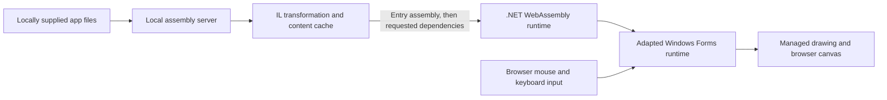

# Architecture

## Execution path

Original application files are read as inputs. Transformed copies are generated separately. The server prepares and serves code; managed application execution and rendering happen in the browser.

## Components

| Component | Role |
| --- | --- |
| `runtimes/winforms` | Vendored upstream WinForms sources and notices. |
| `src/WfWasm.WinForms` | Runtime overlays and managed replacements for Windows-specific behavior. |
| `src/WfWasm.Drawing` | Managed implementation of the supported drawing surface and virtual file access. |
| `src/WfWasm.Rewrite` and `.Tool` | Assembly analysis, reference remapping, and compatibility transformations using Mono.Cecil. |
| `src/WfWasm.CanvasHost` | Browser application, canvas presentation, input, app loading, and measurements. |
| `src/WfWasm.Host.Server` | Development server, assembly delivery, transformation cache, and error inventory. |
| `src/WfWasm.PdnCpu` | Optional managed helpers used by the Paint.NET compatibility experiment; no Paint.NET binary is bundled. |

Other source projects contain analysis tools, supporting shims, and earlier rendering experiments. The build script follows the active canvas host path.

## Dynamic loading

The shared runtime is built once for the host. Each external app starts with a manifest describing its entry assembly and declared loose content. An assembly resolution callback requests missing assembly names from the same local server. The server performs exact file lookups in configured roots and applies the configured transformation policy. It does not enumerate those roots into a download bundle.

Returned assembly payloads are checked against SHA-256 values before loading. The server cache keys include the relevant transformation inputs. The HTTP cache and client memory reuse reduce repeat delivery. The current synchronous resolution bridge and eager loose-content loading remain areas for improvement.

## Rendering and measurement

The adapted controls paint through the managed drawing layer. The canvas bridge presents the output and translates browser input into host events. A first canvas frame ends the displayed app load timer; it does not prove that every application workflow or background operation is ready.

Application data reports uncompressed payload bytes. Network transfer reports measured HTTP transfer separately. Browser resource timing and cache behavior affect these values, so screenshots of warm sessions should not be treated as cold network benchmarks.

## Compatibility boundaries

Rewriting a reference or providing a matching API signature does not reproduce all Windows behavior. Native services, synchronous UI assumptions, file persistence, accessibility, advanced controls, and graphics require their own behavior tests. Some implementations are partial or stubs. An app rendering successfully is one checkpoint in a longer compatibility investigation.
