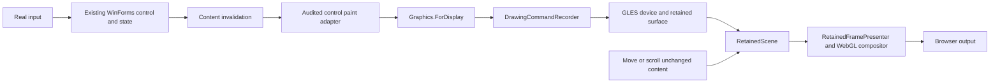
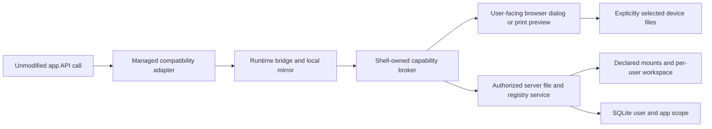

# Connecting retained rendering and platform services to real applications

Status: 21 October 2026. This is a source-grounded integration plan plus an optional compilable skeleton. The skeleton is not referenced by CanvasHost, does not change current app painting/dialog/registry behavior, and is not a GPU/backend or full platform implementation.

## The practical difference

The rendering work is about how an application draws: turn supported drawing operations into GPU commands and retain their results so moving an unchanged window does not repaint its contents.

The platform work is about what a desktop application can access: application files, declared server folders, files selected by the browser user, virtual registry settings and printing. Access needs a session-owned broker with explicit outcomes, rather than empty return values that appear successful.

They are separate subsystems. They meet at the same app runtime/session, input loop, cancellation/disposal lifecycle and evidence trail. Neither should be global state shared between unrelated app sessions.

## 1. Rendering: implemented pieces and missing connections

| Current source | What it actually does | Limit |
| --- | --- | --- |
| `WfWasm.Rendering` | Immutable drawing batches; device/surface identity and content versions; retained scene placement; presentation; CPU access contracts | Interfaces and coordination are not a complete renderer |
| `WfWasm.Rendering.Gles` | A bounded device/compositor through `IGlesContext`: solid rectangular fills/clips, image blits, compositing, resources, CPU leases and lifecycle | Factory explicitly excludes general paths, strokes, gradients, complex clips and its text service |
| `CanvasHost/GpuProbe.cs` and `wwwroot/gpu-bind.js` | Browser WebGL binding and a separate fixture/probe path | A probe is not normal application painting |
| `Drawing/DisplayGraphics.cs` | `Graphics.ForDisplay` records supported operations into a drawing batch; supported text uses explicit CPU glyph scratch images | Incomplete Graphics contract; glyph rasterization still has a CPU cost; not whole-UI GPU drawing |
| `CanvasHost/WinFormsAppHost.cs` | Normal retained/self-paint paths still create CPU `Bitmap` and `Graphics.FromImage` | Required-GPU mode explicitly rejects the software target |
| `RenderSessionFactory` | Selects a complete display backend before app painting; requires `DrawingFeatures.Display` | Current GLES subset does not satisfy full required-GPU policy |

There is already CPU bitmap retention in the normal host. The missing milestone is not simply adding a cache: it is routing a real control's drawing through the display recorder and GPU device, while preserving the control's behavior and reusing its retained surface.

### Target data flow



Changing content invokes the correct background/paint lifecycle and updates the surface content version. Changing placement updates transform, clip, opacity or z order while preserving surface/content identity. With no change, the presenter should submit nothing. This resembles the useful part of a desktop compositor: reuse existing content rather than rerunning application drawing whenever a window moves.

This does not mean every WinForms control becomes accelerated automatically. Complex drawing needs matching command semantics, text metrics, clipping and resource lifetime. Uploading a CPU-rendered whole control texture may accelerate composition, but must not be reported as GPU execution of the control's drawing.

### New skeleton

`src/WfWasm.AppIntegration/ControlLayerBridge.cs` connects existing pieces through `IControlPaintAdapter`, without taking a dependency on WinForms or Drawing:

- Requires a connected, explicitly audited adapter and an already selected compatible GPU device before allocating or invoking app paint.
- Owns one control surface and retained layer; it does not own the whole device or session.
- Repaints the complete layer onto transparent pixels on content change. Partial damage is intentionally not implemented here.
- Calls the adapter once; queues the batch and refreshes the layer's content version.
- Updates placement without repaint. Existing `RetainedFramePresenter` remains responsible for composition/submission.
- Propagates unsupported/failing paint, removes stale content, faults the binding and never silently retries it on the CPU.
- Rejects foreign/stale surfaces. Disposal releases only its own surface/layer, including when a newer binding has reused the logical control ID.
- `DisconnectedControlPaintAdapter` explicitly fails. It is not a test control masquerading as an app integration.

### Wiring into the existing host

1. Introduce a disabled-by-default, narrowly scoped real-control pilot. Select a concrete control whose complete paint vocabulary is audited. Do not enable every arbitrary control or change full `RequireGpuRendering` policy to accept a partial backend.
2. In the host's app-runtime lifecycle, create the actual WebGL device once, before any code binds a 2D context to the intended GPU presentation canvas. Give the pilot its own clear lifecycle/ownership policy.
3. Implement the WinForms adapter in CanvasHost. Construct `Graphics.ForDisplay(recorder, device.Images.Import)`, apply correct target extent, DPI/transform/clip and invoke the real control's background/paint lifecycle once. Preserve the distinction between parent painting, child ownership, nonclient drawing and overlays.
4. At host invalidation, mark content dirty. At movement/scroll/z-order change, update placement. At the frame boundary, paint dirty bindings then call `RetainedFramePresenter`. The scene must contain fresh snapshots after enqueuing content.
5. Map logical WinForms coordinates to presentation pixels consistently with DPR and inverse input hit testing. The skeleton placement matrix is in presentation pixel coordinates. It does not implement input routing or a desktop window manager.
6. On resize, eviction or device loss, invalidate/remove old bindings and explicitly recreate targets/bindings. Restore content from application state. Never relabel old handles as current or silently reenter a paint callback that already failed.
7. For unsupported controls, select a deliberate CPU path before their paint and report mixed-mode costs honestly. Do not replay a partially executed callback as fallback. Partial in-paint CPU access needs incremental submission/state barriers; the existing recorder explicitly rejects that unimplemented case.
8. Fix/verify fresh/reset clip extent, compositing Save/Restore, text metrics and supported image behavior before expanding the pilot. The skeleton does not repair those existing drawing contracts.

Do not allocate a separate large GPU texture for every tiny widget by default. Choose ownership/invalidation units from measured control/window behavior and a resource budget. One bounded real control is an integration milestone; a complete window compositor is a later scope.

## 2. Platform services: implemented pieces and missing connections

| Current source | What exists | Limit |
| --- | --- | --- |
| `Platform.Server/VirtualFiles.cs` | Declared file/directory mounts and workspace operations, bounded by configured policies | Not automatic access to a server drive or browser-user disk |
| `Platform.Server/VirtualRegistry.cs` | SQLite keys and typed values scoped by user/app; case normalization, quotas, QWord represented as decimal text | Existing `RegistryKey` call sites do not consistently use it |
| `Platform.Server/PlatformModels.cs`, `PlatformEndpoints.cs` | Server-owned identity/session, protected anonymous cookie or authenticated principal, origin checks and endpoints | Local demo behavior is not a complete multi-user deployment |
| `Platform.Browser/platform-client.mjs` | Async client, browser file handles, synchronous JS registry mirror with queued durable writes | A JS mirror is not yet a legacy managed RegistryKey implementation |
| `Platform.Browser/platform-ui.mjs` | Async open/save/folder UI, direct user-gesture device picker, bounded image-page print preview | Cannot synchronously block the browser UI thread; print dialog cannot confirm paper delivery |
| `Platform.Browser/platform-rpc.mjs` | Exact-origin/source/session-bound parent/child broker and bounded async RPC | Must be mounted/disposed with the real shell/runtime; not currently wired there |
| `WfWasm.Platform.Demo` | Separate working service/demo composition | Not the normal app host |
| `WinForms/WasmRegistry.cs` | Current generic registry hooks return null/defaults and make writes no-ops | Avoids some crashes but does not persist app settings |
| `Drawing/AppFileSystem.cs` | App-content byte registry and validated MEMFS materialization for framework readers | Primarily content/bootstrap plumbing; not the complete mounted persistent filesystem |

The existing server code scopes registry/workspace state by stable **user + app**, allowing settings to survive a new runtime session. Runtime/session IDs are transient routing/lifetime identities. Server authorization must derive the user from a trusted cookie/principal; never trust a user ID supplied by the app.

### Target data flow



The app should see virtual names such as `workspace:/Documents/report.txt` or an agreed Windows-like mapping. Device grants should be opaque capabilities, not a discovered physical path. Separate app assets, read-only server mounts, writable workspace and explicitly selected user files. Keep mount identity when resolving names; loose tail-name matching alone is unsafe for multiple mounts containing the same filename.

### New skeleton

`PlatformSessionBridge.cs` provides a small typed async facade matching existing RPC operation names:

- `dialog.open`, `files.read`, `files.write`;
- `registry.snapshot`, `registry.set`, `registry.flush`;
- `print.preview`.

It preserves runtime identity, copies deferred write/print buffers, clones registry JSON, waits for acknowledgements, passes cancellation and rejects late/rebound-session replies. Print results distinguish preview readiness from actual physical printer delivery. It rejects raw host paths at this seam; the existing server remains the authoritative validator/permission boundary.

`IPlatformSessionTransport` is deliberately unwired. Its implementation must use the existing `PlatformRpcClient` protocol rather than creating another endpoint/auth system. It must marshal camel-case DTOs and byte memories to JS `Uint8Array`, not rely on ordinary JSON byte-array base64 encoding. .NET cancellation must propagate to the JS request/lifetime machinery; cancellation does not inherently roll back a write already accepted by the server.

`DisconnectedPlatformTransport` always reports unavailable. An unconnected read must not turn into an empty resource/settings result, and an unconnected write must not appear saved. This facade is **not** a FileStream, RegistryKey, PrintDocument or synchronous ShowDialog implementation.

### Wiring into the shell/server/runtime

1. Add/configure `AddWfPlatform` and `MapWfPlatform` in the real Host.Server with private data directory and explicit app/mount allowlists. Reuse the existing service; do not build a second SQLite registry.
2. In `shell-ui.mjs`, create one `PlatformClient` for the selected app. When mounting its child frame, bind `bindPlatformHost` to the exact window/origin/runtime session. Keep server cookies/tokens and user selection UI out of the child.
3. In the runtime bootstrap, construct the .NET/JS transport and hydrate required registry/file metadata before constructing the app. A readiness state must distinguish service unavailable from a genuinely absent key/file.
4. Keep a session-local synchronous managed registry mirror for ordinary app reads. Preserve typed values, enumeration, create/open/delete/default semantics and app scope; queue writes through the existing broker and expose durable flush failures. Define concurrent-session conflict behavior rather than silently overwriting stale full snapshots.
5. Build a valid managed key API/type mapping. The current rewriter hooks use real `RegistryKey` signatures: returning an unrelated virtual object without rewriting typed locals/fields/returns/generics is invalid. Use real compiled consumers to prove the chosen contract. Do not repeat a return-type substitution bug.
6. Integrate mounted files with environment/drive/directory APIs and app file streams. Framework readers like XML/DataSet can bypass rewritten System.IO call sites, so validated materialization or a proper VFS is needed. Define read/write/close/flush semantics and persistence errors explicitly. DLL resolution remains dynamic and separate from user file grants.
7. Connect file dialogs only once the synchronous/resumable execution decision below is made. Returning `DialogResult.None` immediately is not equivalent to a completed OpenFileDialog. Before resuming an Open caller, install selected bytes/path metadata so its immediate FileStream/read succeeds.
8. Connect PrintDocument events to bounded page rendering, then the existing print-preview UI. Preserve page dimensions, margins, landscape, DPI, HasMorePages, cancellation and Begin/PrintPage/End ordering. CPU page rasterization can be an explicit print/export operation; it must not be hidden inside normal GPU UI drawing counters.
9. Graceful app close flushes registry/persistent writes, reports failure, revokes the platform session, aborts pending dialogs/RPC and disposes handles/print previews. A crashed/replaced app needs emergency teardown that does not claim unflushed data was saved. Late replies must not affect the new app.

### The synchronous API problem must be solved explicitly

Classic code often says `if (dialog.ShowDialog() == OK) Read(dialog.FileName);`. Browser device permissions and dialogs are asynchronous and require an actual user gesture. Blocking the browser UI thread with `.Wait()`, `.Result`, spin loops or a nested fake message pump prevents the dialog/permission interaction from completing.

Two possible integration strategies need a measured prototype:

| Strategy | Benefit | Cost/required proof |
| --- | --- | --- |
| Managed app in a dedicated worker; UI broker remains on the browser thread | Can preserve synchronous legacy callers while only the worker suspends | Runtime/interop/OffscreenCanvas/threading changes; worker-safe waits; required isolation headers where shared memory is used; browser coverage; modal/input reentrancy and cancellation tests |
| Narrow, explicitly supported continuation rewriting | Can pilot selected existing caller patterns without moving the whole runtime | Must preserve surrounding locals, branches, exception/finally regions, results and event flow; not a general conversion of synchronous .NET into async |

Do not select a broad worker/scheduler rewrite just to demonstrate a picker. First wire bootstrap registry and an async service roundtrip, then prototype one actual file-dialog caller. For a general unmodified legacy program, a resumable execution boundary is necessary; the new async facade alone does not provide it.

Whichever strategy is chosen, the host dialog should have a real “Choose files from my device” button whose click invokes the native picker directly, before unrelated awaits. Receiving a worker/RPC message does not itself grant transient user activation. Never assume device permissions can be requested invisibly from startup.

## Shared app lifecycle

```text
mount app frame
  -> bind exact runtime identity and capability broker
  -> initialize service metadata / registry mirror
  -> select rendering policy and audited pilot controls
  -> construct app
  -> process input, content damage, placement, file/registry/print operations
  -> verify useful frame + required initialization before ready
  -> graceful flush or explicitly reported crash teardown
  -> cancel old work / release layers, resources and capability handles
```

Do not attach readiness to a constructor, command enqueue, first blank frame or service-demo success. Use separately observed app workflows and pixels/data/file results. A rendering submission receipt is not proof of visibility; a print-preview receipt is not proof of physical printing.

## Build and test the new seam

```powershell
dotnet test tests/WfWasm.AppIntegration.Tests --nologo
```

The new project references only `WfWasm.Rendering`, avoiding dependence on the mutable migrated fork or vendor inputs. Neither it nor its tests are added to the shared solution or production host automatically.

Tests cover no-paint preflight rejection, movement/content distinction, retained versions, no replay after a paint fault, disposal ownership, explicit disconnection, cancellation/late-session replies, write snapshots/acknowledgement, registry value fidelity, virtual path rejection and honest print receipts. These are protocol/lifecycle checks with test doubles. They establish neither real browser interop, hardware pixels, working legacy app dialogs nor performance.

## Integration milestones and evidence

1. **Rendering pilot:** one real existing control in normal Host paint, actual browser input, independent pixels, one paint per content update and no paint on placement-only changes. Report CPU glyph/import costs honestly.
2. **Registry pilot:** existing app setting changes, survives close/reopen, exact typed value, isolated second user/app; failed storage remains visible.
3. **File pilot:** a real Open caller chooses a declared fixture file, then a browser-selected device file, immediately reads the correct bytes, handles cancel/denial and saves a decodable output within its grant.
4. **Print pilot:** real PrintDocument event path produces correct multi-page preview; user requests browser printing; completion state stays honest.
5. **Lifetime/performance:** switch apps during work, reject stale replies, bound memory/texture growth, context-loss recovery and calibrated input-to-observable-output measurements.

Use [the agent handoff](integration-agent-prompt.md) for ordered implementation instructions. Keep the existing GPU gate strict. Do not turn passing the new seam's tests into a claim that integration is complete.
