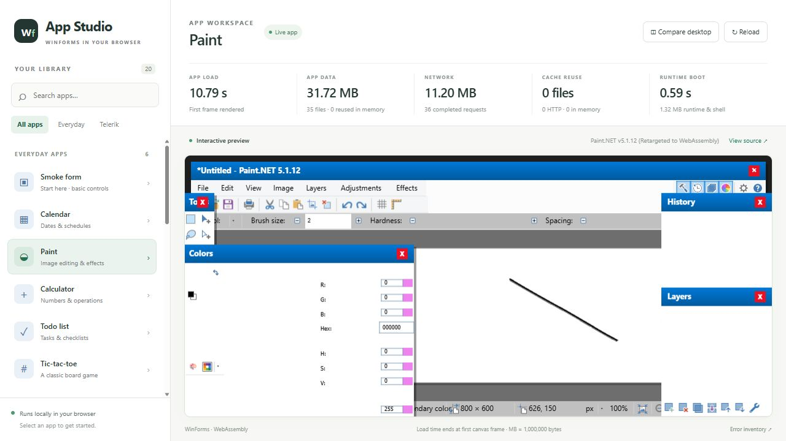
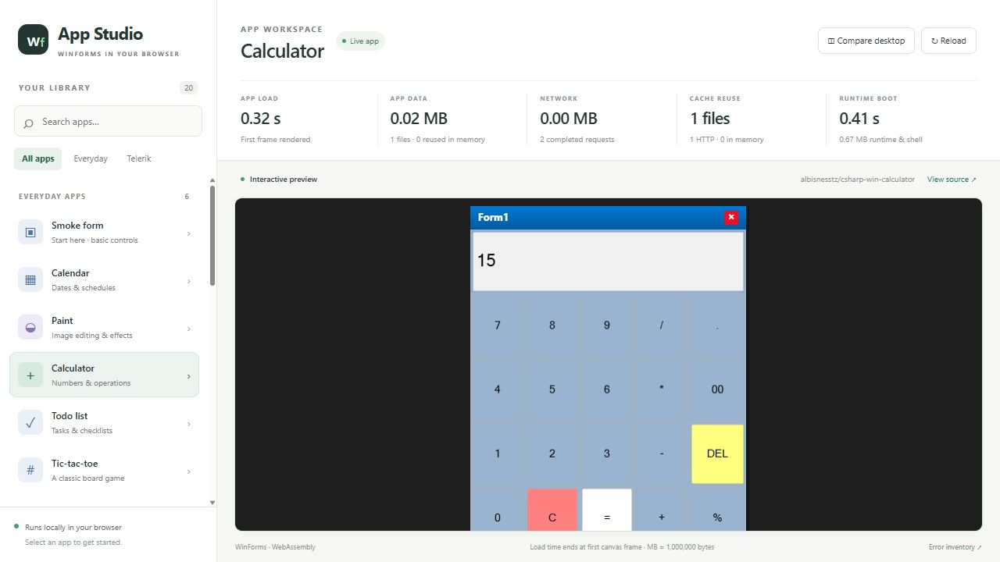
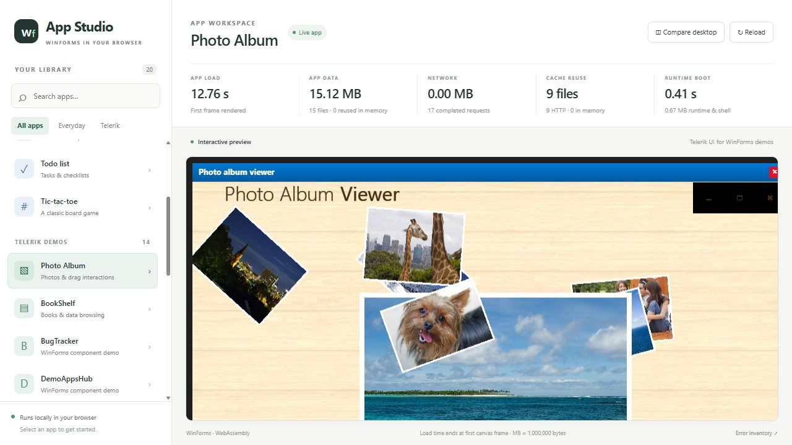
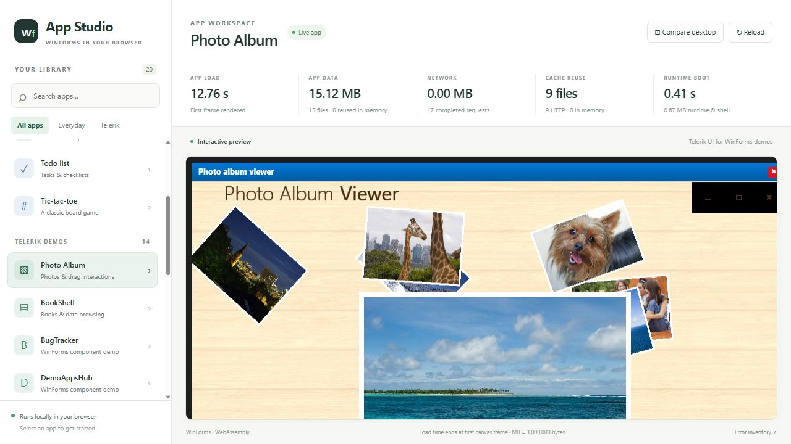
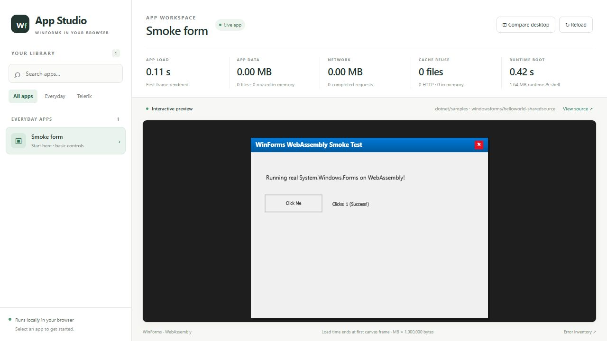

# Captures — 24 October 2026

Two unaltered 1500x1000 PNGs from fresh-profile headless Edge on the local
development host: paint-net-palette-before-2026-10-24.png and
paint-net-palette-selected-2026-10-24.png. The latter follows a real palette
click at (418,878): swatch, wheel marker and RGB/hex change to 0/255/144,
00FF90. A Layers thumbnail is visible; independent layer behavior is not proven.
A later brush/layer sequence crashed during command-list finalization. These
captures do not imply that the whole session or editing workflow passed.

The separate base-project-2026-10-24.png capture comes from a freshly extracted
source-only tree, built without application inputs and served on port 5390.
Its real button was clicked and the visible counter changed to 1. The library
has one available built-in form and 27 optional unprepared benchmarks; this
base run had no console/page errors.

See [exact validation and limitations](../update-2026-10-24-colors-and-panels.md).
Payloads, converted binaries and loose application assets are excluded.
Application UI/artwork retains its owners' rights.

# Live browser captures

## 22 October 2026 — panel/thumbnail follow-up

Fresh unaltered PNG captures from the development browser at 1093×884. The app is the separately supplied Paint.NET 5.1.12, not the historical OpenPDN benchmark. Close the app-library sidebar, drag History and Layers toward the right, click the visible colour wheel, then draw `(400,320) → (440,460) → (480,350) → (520,460) → (560,320)` as four separate brush drags.

| Capture | Action/result | Boundary |
|---|---|---|
| [Readable panels and four brush strokes](paint-net-panels-2026-10-22.png) | Colors shows RGB/HSV/opacity labels and values; History lists Paintbrush entries; a Layers preview is visible; the document contains a green W | Some toolbar controls remain blue blocks/partial; thumbnail freshness and per-layer accuracy are incomplete |
| [Undo to blank](paint-net-panels-undo-2026-10-22.png) | Four Ctrl+Z actions clear all strokes and select New Image in History | One sequence, not arbitrary history or saved-state correctness |
| [Toolbar redo](paint-net-panels-redo-2026-10-22.png) | Four clicks at the visible Redo button restore the strokes | The automated keyboard redo attempt had no visible effect; only toolbar redo is established here |
| [Clean source-only startup](base-project-panels-2026-10-22.png) | Separate fresh staged-source export, with no app inputs, displays the built-in form and 27 Needs preparation entries at 1280×720 | Startup/rendering only; the coordinate input attempt did not arrive in the app log, so this is not a new button-interaction pass |

Independent document-region `(380,300)–(580,480)` green-pixel counts are 1,152 / 0 / 1,151 (green >180, red <180, blue <100). This is a visible roundtrip with a small pixel difference, not exact parity. The first redo attempt's blank capture was replaced only after the actual toolbar workflow succeeded; no pixels were edited. The captured console warning/error list was empty; that is not a full backend error-inventory acceptance test.

These captures used the development host on port 5210, with the app files supplied separately. UI state/panel placement changed through normal input only. See [the follow-up validation and limitations](../update-2026-10-22-panels.md).

## 22 October 2026

Fresh, unaltered JPEG captures at the browser's natural viewport: 2560×855 for external apps and 2560×911 for the source-only form. No screenshot editing, desktop references or generated images. The browser viewport changed naturally between captures; these are not fixed-size visual-regression baselines.

| Capture | Actual action and observed result | Limit |
| --- | --- | --- |
| [Paint.NET stroke](paint-net-2026-10-22.jpg), [undo](paint-net-undo-2026-10-22.jpg), [redo](paint-net-redo-2026-10-22.jpg) | Drag `(800,360) → (1020,510)` once; press Ctrl+Z then Ctrl+Y. Stroke disappears and returns. Independent image analysis of `(790,350)–(1030,520)` finds 632, 0 and 632 dark pixels respectively. | One visible roundtrip. History labels, modified/saved semantics, persistence, memory bounds and arbitrary effects are not certified. |
| [Paint.NET Levels](paint-net-levels-2026-10-22.jpg) | Open Adjustments → Levels. Its real dialog renders; close it with X. | Incomplete controls and no visible OK/Cancel actions; no non-default effect application claim. |
| [MedicalApp registration](medical-registration-2026-10-22.jpg) | Click Register new patient; actual fields appear. | Attempted first-name input produced no visible text; no save/data-validation/persistence claim. |
| [Map Selection](map-selection-2026-10-22.jpg) | Click Brazil at `(1160,506)`; its actual polygon becomes cyan. | The SelectedCountries area remains empty; list/data behavior unverified. |
| [Source-only base](base-project-2026-10-22.jpg) | Build the public source snapshot; its library contains one form. Click its button; the counter shows `Clicks: 1 (Success!)`. | Base-build/input evidence, not external app compatibility. |

External-app observations used the separately configured development host on port 5210. The source-only build used port 5391 with development static assets enabled. Their build/runtime configurations differ; the screenshots are not whole-repository reproducibility or performance receipts. Session counters show warm/cold states as encountered, not comparable load benchmarks.

See the [dated implementation review](../review-2026-10-22.md) for test failures, remaining work, discarded automation evidence and publication boundaries. App binaries, converted assemblies and loose assets remain excluded; application UI/artwork retain their owners' rights.

## 21 October 2026

These JPEGs are unaltered browser screenshots at the normal 1280×720 viewport. No desktop screenshots, generated mockups or image edits were used. Fixed-size desktop windows still exceed or crowd the available area in some cases; those limitations remain visible. The local development app corpus is separately supplied and excluded from this repository.

| Capture | Action and independently observed result | Limit |
| --- | --- | --- |
| [Paint.NET](paint-net-2026-10.jpg) | Four brush drags draw a W-shaped stroke; the document title becomes modified. | Basic painting only; panels and editing/file/effect workflows incomplete. |
| [Map Selection](map-selection-2026-10.jpg) | Click Brazil; its real country polygon changes to cyan. | No pan/zoom/data parity claim. |
| [Barcode](barcode-update-2026-10.jpg) | Enter `/wasm`, click UPDATE; OpenCV QRCodeDetector independently decodes the image to `/wasm`. | Other symbologies/validation untested in this capture. |
| [Diagram Nodes](diagram-nodes-2026-10.jpg) | Open the actual sample; node shapes, rich-text node, toolbar and property grid render. | Startup/rendering evidence; drag/edit/save not verified. |
| [Source-only base](base-project-2026-10.jpg) | Build the public source checkout and open its built-in form with no external apps installed. | A base-build check, not the external demo corpus. |

The development captures used the local preview on port 5210. The base capture used a separate source-checkout host on port 5390. Counters show the particular sessions, including warm caches; they are not calibrated load/performance comparisons. See [progress and validation](../progress-2026-10.md).

Application names, UI and artwork retain their owners' rights. [Third-party notices](../../THIRD-PARTY-NOTICES.md) explain the source-only and attribution boundaries. No app library, executable, converted assembly or loose app asset accompanies these captures.

# Earlier captures — 15 October 2026

Captured on 15 October 2026 from the running local browser host. Images are unaltered browser captures at its normal viewport; large application canvases extend beyond the visible area. These are browser observations, not native desktop reference images or pixel-parity claims.

## Paint.NET — partial compatibility

The browser runs a separately obtained local copy of Paint.NET 5.1.12 through the compatibility layer. The capture shows the editor interface and a visible stroke after a brush drag in the document area.

This is the most ambitious demo shown here, and it is still only partially working. Rendering and editing functionality are incomplete; this capture does not establish that tools, effects, file operations, or complete editing workflows work correctly. Paint.NET files and converted assemblies are not included in the repository.

## Calculator input

Interaction: click `7`, `+`, `8`, `=` in a fresh browser session. The display changes to `15`. The displayed load time is time to the first canvas frame in that session; it is not a cold-download benchmark.

## Photo Album drag

Interaction: drag the dog photo from the middle of the canvas to the upper right. The before and after captures show its changed position. The browser host shows loading and byte measurements above the canvas; cache state affects those measurements.

These external applications were supplied separately for local testing. Their files and conversion outputs are excluded from the repository. See [third-party notices](../../THIRD-PARTY-NOTICES.md).

## Base project

This separate build used only the source distribution and restored build dependencies. The library contains the built-in form, with no external applications installed. Clicking its button increments the visible success counter.
