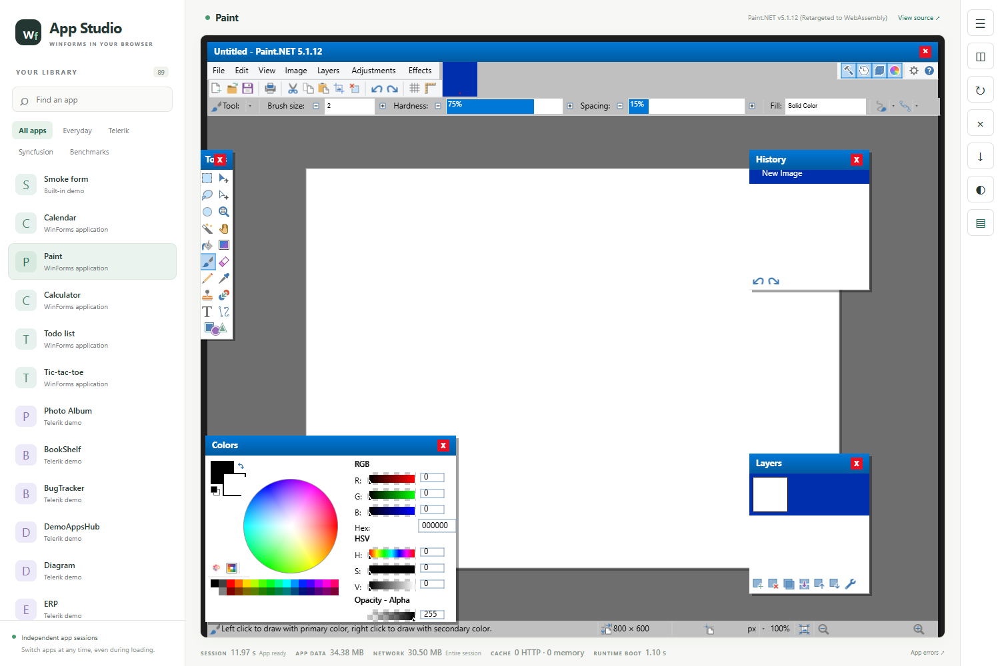

# Colors, drawing and compatibility update — 24 October 2026

This is a source-only work-in-progress checkpoint. Original app executables,
converted assemblies, vendor demo sources/assets, build outputs, caches and
private diagnostic logs are excluded. Existing applications remain external
inputs; the base project and original business logic are distinct artifacts.

## What the browser captures establish

The separately supplied Paint.NET 5.1.12 opens with the Colors wheel, RGB/HSV
labels/values, opacity controls, palette strip and floating Layers/History
windows visible. Clicking the palette at browser coordinates (418,878) updates
the primary swatch, wheel marker, RGB values to (0,255,144) and hex to 00FF90.
The unaltered 1500x1000 captures show before and after selection.

The Layers window has a visible preview. This does not prove correct independent
layer thumbnails, layer creation, visibility, composition or editing. Two
longer brush/layer attempts ended with InvalidCastException from
CpuPaint.FreeScratchTarget through CpuCommandList.Finalize, terminating the
runtime with exit 255. Subsequent commands in that dead session are not tests
of layer creation or undo. Those workflows remain failed/unverified in this
checkpoint. Existing earlier brush/undo screenshots document earlier builds;
they are not substituted for successful validation of the current sequence.

The successful color-selection capture precedes that later failure. It is
rendering/color-selection evidence, not a claim of a clean complete session.
The runtime is disposed on failure, but another app's recovery was not retested
in this publication pass. Native desktop parity and export/save are untested.

## Included implementation progress

- CPU command-list scratch/composition support for Paint.NET drawing; ownership
  and finalizer behavior still require the repair described above.
- Rectangular clipped solid-fill fast paths and pixel-shift operations, with
  clipping/alpha tests. Scroll-shift reuse is deliberately narrow; this is not
  a measured rich-text scrolling speedup or complete retained compositor.
- Diagnostics restored to a coordinated default-off gate with explicit runtime
  enable/disable, instead of unconditionally enabling drawing/frame counters.
- Mouse coordinates anchored to the actual modal/docked target, button paint
  routing, cursor/scroll handling and native-style spin drawing compatibility.
- Resource/image loading, virtual binary reads, isolated-storage overloads,
  file-version queries and additional assembly-rewrite compatibility rules.
- Benchmark content declaration for supported loose images/data. Dependencies
  continue to load dynamically; adding a folder does not preload all DLLs.
- Gallery verifier checks for contradictory passed rows, scoped expected errors,
  required cases and acceptance versus evidence validity. Self-tests validate
  the checker; they do not establish real application compatibility.

## Validation

The portable publication checkout built with scripts/build.ps1 (333 warnings,
zero errors in the final host build). The pre-existing focused source-only
scripts/test-base.ps1 gate passed: 494 Drawing, 25 host and four rewriter checks.
This is a separate documented subset, not a replacement for the failed full run.

Every native *.Tests project was also run unfiltered and sequentially, with
bounded hang diagnostics: **17 projects, 1,906 passed, 25 failed, zero skipped**.

| Suite | Passed | Failed |
|---|---:|---:|
| Analyzer | 1 | 2 |
| AppIntegration | 20 | 0 |
| CanvasHost | 256 | 11 |
| Drawing | 494 | 0 |
| ErrorLog | 11 | 0 |
| Host.Server | 156 | 0 |
| IsolatedStorage | 9 | 0 |
| Packager | 2 | 2 |
| PdnCpu | 106 | 0 |
| Platform | 41 | 0 |
| Renderer | 13 | 0 |
| Rendering.Gles | 55 | 0 |
| Rendering | 33 | 0 |
| Rewrite | 227 | 5 |
| Shim | 226 | 0 |
| Skia | 8 | 0 |
| WinForms | 248 | 5 |

Failures include absent optional baseline/app inputs and generated evaluation
results; the WindowsBase integration assertion; a portable framework-output
path mismatch; two real-fork Cecil dependency-resolution failures; empty-source
WheelBitmap behavior; and the non-effect modal disposal assertion. They remain
failures, with no skipped cases, blanket waivers or weakened assertions.
Some other integration tests return early without optional inputs, so native
pass totals are not counts of exercised external application workflows.

Additional checks: 33 shell-isolation Node tests, 24 gallery checker self-tests
and seven archive-reader tests passed. GLES tests exercise contracts, not
hardware-GPU acceptance. The staged source tree was also extracted into a new directory without app
inputs: build and the same focused base gate passed. A fresh browser showed
28 entries (one available built-in form and 27 unprepared optional benchmarks);
clicking its real button changed the counter to 1, with no console/page errors.
Broader application, GPU and performance acceptance was not run.

The current development browser and the exported-source checks are separate
observations. Screenshots come from the locally configured application host;
its app payloads are not part of the public source distribution. The export
preserves portable paths, package versions and strict public failure gates.

## Next fixes

1. Reproduce scratch-target ownership and command-list finalization under GC;
   prevent stale/double ownership with a real lifetime fix and runtime tests.
2. Re-establish brush, add-layer, independent-color/visibility and undo/redo
   workflows against the exact exported runtime. Verify document and per-layer
   pixels independently; do not accept only a thumbnail or ready marker.
3. Resolve portable fixture/dependency setup and remaining behavioral failures
   without changing assertions to fit a broken implementation.
4. Measure sustained rich-text scrolling with diagnostics off, document latency
   distributions, and validate clipping/retained reuse before performance claims.
5. Continue original benchmark startup and useful workflows using the existing
   preparation reports. Prepared inputs remain separate from working browser apps.
