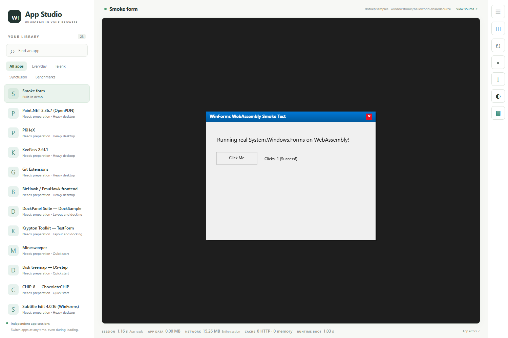

# Drawing and resource-lifetime checkpoint — 26 October 2026

This source-only update publishes a reviewed subset of the development work.
Original applications, converted binaries, vendor inputs, caches and private
diagnostic logs remain excluded. Compatibility is still in progress.

## Included changes

- Paint.NET command-list scratch targets now have distinct allocation IDs,
  synchronized ownership transfer and stale-ID guards. Rewriter changes match
  the CPU backend. Six original-assembly ownership/consume tests pass, including
  repeated GC-pressure cycles. This addresses the ownership design behind the
  earlier cleanup crash, but browser editing remains unverified.
- Text layout gains single-line trimming/ellipsis handling, GDI text respects
  ETO_CLIPPED and DT_NOCLIP, and connected path segments preserve their join.
  Image-list decoding handles additional serialized image shapes.
- Private in-memory fonts can be registered with the browser FontFace API;
  cached text rasters/widths are cleared when a family becomes available.
  Transient registration failure/retry and real vendor icon fidelity still
  need browser acceptance.
- Form.Load is guarded against duplicate host invocation, which otherwise can
  add the same data binding twice. Maximized forms receive viewport placement
  on startup and resize. Ordinary modal disposal is synchronous; effect-dialog
  deferral remains a separate compatibility path.
- Additional platform, storage, renderer, Skia, analyzer and error aggregation
  contracts exercise the existing implementation. These are not proof of full
  production wiring into every WinForms application.
- The optional full-WindowsBase build fixes a Windows command-line quoting
  problem when its intermediate directory ends in a backslash. Its existing
  bundle gate now completes in the tested configuration.

## What was held back

The first broad candidate failed 23 CanvasHost tests, including disposed-control
callbacks and missed modal/dropdown actions. New native focus storage,
mouse-down Focus calls, blanket effect-window suppression and a reentrant
bounds queue were excluded from this publication. The curated host suite
returns to its previous 11 failures. The original development workspace retains
those edits for diagnosis; the public update does not claim that work is ready.

## Validation and limits

The portable base build succeeds. All 17 native test projects were run
unfiltered and sequentially, with bounded hang diagnostics:

| Suite | Passed | Failed |
|---|---:|---:|
| Analyzer | 6 | 2 |
| AppIntegration | 55 | 0 |
| CanvasHost | 259 | 11 |
| Drawing | 513 | 0 |
| ErrorLog | 24 | 0 |
| Host.Server | 156 | 0 |
| IsolatedStorage | 38 | 0 |
| Packager | 6 | 2 |
| PdnCpu | 106 | 0 |
| Platform | 63 | 0 |
| Renderer | 25 | 0 |
| Rendering.Gles | 55 | 0 |
| Rendering | 45 | 0 |
| Rewrite | 235 | 4 |
| Shim | 226 | 0 |
| Skia | 24 | 0 |
| WinForms | 255 | 4 |
| **Total** | **2,091** | **23** |

There were zero skipped cases. Failures include missing optional baselines,
rewritten sample inputs and evaluation reports; a framework-output path
assumption; Fiddler input preparation; two Cecil drawing resolution failures;
WindowsBase native binding; and Paint workspace/stroke integration. Some other
tests return early without optional inputs, so passes are not counts of
exercised application workflows. A second broad candidate had 5 rewriter
failures; the curated run had 4. This is a recorded run, not proof that every
previously intermittent failure has been permanently fixed.

Additional checks passed: 166 Node shell/rendering-contract tests, 24 gallery
checker self-tests and seven archive-reader tests. These do not establish real
GPU acceleration or faster scrolling.

The staged source tree was extracted into a fresh directory with no external
application inputs. Its build and focused base gate passed: 513 Drawing,
25 loader/host contracts and four synthetic rewriter cases. In a fresh browser,
the built-in form responded to a real button click with `Clicks: 1 (Success!)`.
There were no console or page errors. The catalog contained 28 entries: the
available built-in form and 27 optional benchmark candidates awaiting inputs.

A default portable browser build failed Paint.NET initialization because the
WindowsBase facade lacks DependencyObject. Rebuilding with an explicitly
supplied full local implementation passes the bundle gate: all 209 referenced
assets present, WindowsBase integrity valid and DependencyObject present.
That fresh browser opened Paint.NET and palette selection displayed
RGB (0,255,144) / #00FF90. The subsequent brush interaction stalled before the
stroke sequence completed and the test was stopped. Existing generic type-load
paint errors were also reported. No successful new layer/undo/long-session
editing or GC-race browser acceptance is claimed by this checkpoint.

See [build configuration](building.md), [testing](testing.md), the
[previous palette captures](update-2026-10-24-colors-and-panels.md) and the
[ordered next-agent tasks](next-agent-2026-10-26.md). Normal application painting
still uses CPU bitmaps; GPU and performance acceptance remain separate work.
